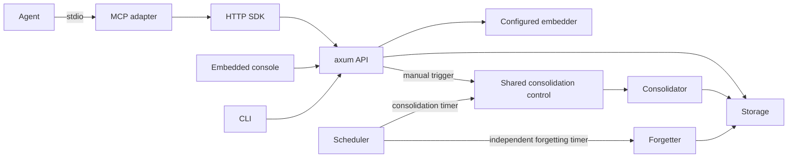
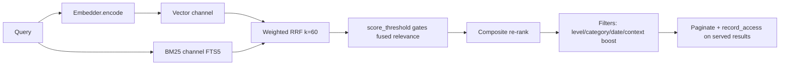
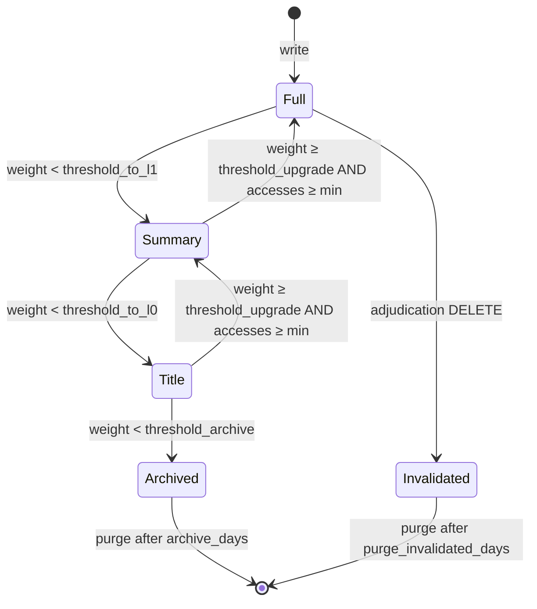
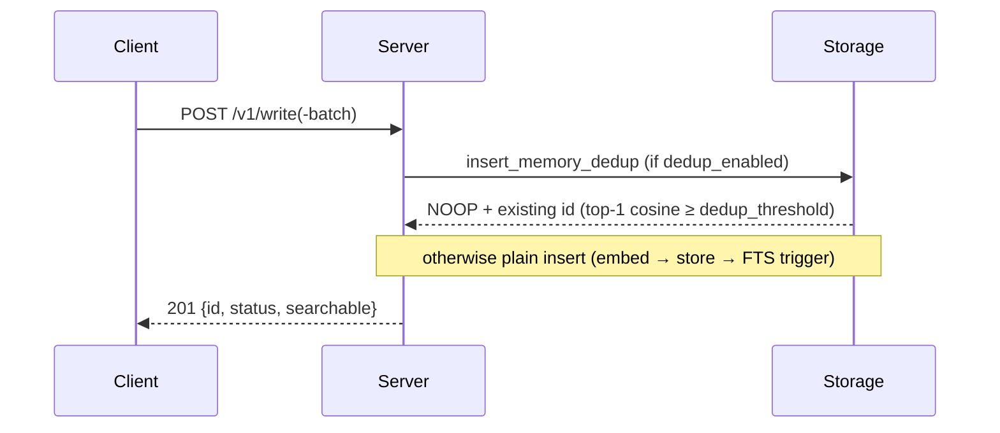

# MerkurDB — Architecture

> [中文版](ARCHITECTURE_CN.md) · Interactive diagram: [diagrams/architecture.html](diagrams/architecture.html)

## Crate Structure & Dependencies

```
crates/
├── core/                # Types, traits, errors, fusion/scoring logic
├── storage/             # SqliteStorage + LanceDbStorage (feature-gated)
├── embedders/           # NoopEmbedder + OllamaEmbedder + OpenAIEmbedder
├── consolidators/       # NoopConsolidator + LlmConsolidator
├── forgetters/          # EbbinghausForgetter
├── server/              # axum HTTP server + Scheduler (consolidation/forgetting ticks)
├── client/              # Rust SDK (MerkurClient trait + HttpMerkurClient)
├── cli/                 # merkurctl admin CLI
├── mcp/                 # stdio MCP adapter using the HTTP SDK
└── eval/                # merkur-eval: LoCoMo + PersonaMem benchmark harness
```

**Dependency direction**: domain types and interfaces live in `core`; storage and plugins implement those interfaces; `server` composes them. `client` depends on `core` and HTTP. MCP and evaluation use `client`; the CLI calls HTTP directly. MCP uses the server's configured embedding provider and governance rather than opening storage.



## Plugin Trait System

Four traits, injected via configuration, independently replaceable:

| Trait | Implementations | Notes |
|---|---|---|
| `Embedder` | Noop, Ollama, OpenAI-compatible | `dim()` probed from the backend at boot; storage adapts |
| `Storage` | SqliteStorage, LanceDbStorage | full read/write surface: memories, edges, FTS5 text search, namespaced vector search, BFS expand, consolidation bookkeeping, soft-invalidation, `record_access`, batch embedding fetch |
| `Consolidator` | Noop, LLM (Ollama or OpenAI-compatible, optional bearer + timeout) | `consolidate()` produces abstracts/importance/edges; `adjudicate()` produces ADD/UPDATE/DELETE/NOOP verdicts |
| `Forgetter` | Ebbinghaus | `compute_weight` + `decide` (downgrade/archive/upgrade) |

The authoritative surface is `crates/core/src/traits.rs`; implement at the trait, configure in `config.rs`, wire in `main.rs`, document in `config.example.yaml`.

## Data Model

`Memory`:

| Field group | Fields | Notes |
|---|---|---|
| identity | `id` | system-generated |
| content | `content`, `abstract_` | `abstract_` written only by the Consolidator |
| salience | `weight`, `importance`, `access_count`, `accessed_at` | `weight` is decayed by the forgetting curve; `importance` is Consolidator-assessed (never client-reported); access recorded at serving points only |
| classification | `category`, `level` (Full=2 / Summary=1 / Title=0 / Archived=-1), `context`, `metadata` | |
| tenancy | `namespace` | every retrieval path is bucket-scoped |
| temporality | `created_at`, `updated_at`, `valid_at`, `invalid_at` | `valid_at` backfilled from `created_at`; `invalid_at` set = soft-invalidated (hidden from retrieval, auditable until purged) |
| consolidation | `pending_consolidation`, `embedding` | |

`Edge`: `source_id`/`target_id`/`weight`/`relation`/`edge_type` (System = LLM-created, bidirectional in BFS; Manual = client-created, directed).

## Storage Layer

### SqliteStorage (default)
- **Metadata**: SQLite, WAL mode, r2d2 connection pool
- **Vector index**: `InMemoryVectorIndex` — `parking_lot::RwLock`, parallel arrays + HashMap, O(n log k) top-k with pre-cached L2 norms
- **Persistence**: live vectors are stored in `memories.embedding` and loaded at startup. Before searching, a scalar generation check discovers changes from other connections/processes. A bounded 4096-event journal drives atomic index deltas; readers beyond that window or with incomplete history reload a consistent live-vector snapshot. Identical vectors, access counts, summaries and importance updates do not dirty the vector cache.
- **Tables**: `memories`, `edges`, `context_tags`, `consolidate_log`, `memories_fts` (FTS5, trigger-synced with every write path), `merkur_meta` (schema version)
- **Migrations**: per-version, transactional, replay-safe; a partially migrated database self-heals on boot

### LanceDbStorage (feature `lancedb`)
- **Metadata**: SQLite (same DDL, same migrations)
- **Vectors**: LanceDB disk storage; startup and insert checks build a Cosine IVF-PQ index at 256 rows and skip training when a matching index exists. Writes append immutable UUID keys before SQLite publishes the reference; legacy keys fall back to the memory ID. Search maps only current references to live memories, and embedding reads query LanceDB. OSS readers check the latest table version on each read.
- **Requires**: `protoc` (build-only), `--features lancedb`

Queries explicitly request Cosine and `refine_factor(1)`: PQ candidates are rescored from full vectors before scores are used for dedup/adjudication thresholds. Missing, unknown or mixed/non-Cosine vector-index metrics use a flat query. The managed default L2 index is replaced by a Cosine index without rewriting stored vectors; custom mixed index layouts remain safely bypassed. New rows outside an existing index remain searchable.

A zero operand has similarity 0, matching SQLite. Zero queries project IDs; incomplete, non-finite or negative native candidate sets use a streaming exact fallback so omitted zero vectors can outrank negative matches. This fallback scans raw vectors with memory bounded by batches plus the candidate limit. ANN recall remains approximate; refinement and metadata checks add work. [Pinned-source evidence and tests](research/cosine-parity.md).

### Shared SQL Logic
`sqlite_helpers.rs` shares row projection (`get_memory_row`), BFS, audit bookkeeping and metadata operations across both backends. The database schema is v8: `content_revision` advances on content, namespace, SQLite embedding or Lance vector-reference publication; summaries and importance do not advance it. Revisions and vector references are internal and are omitted from HTTP responses.

`Storage::apply_adjudication` validates original revisions, namespace, live state and source pending eligibility in one SQLite immediate transaction. UPDATE copies current source content and the SQLite embedding or immutable Lance reference to the target, then invalidates the source in that transaction. DELETE of a named candidate validates that pair. Self-DELETE validates every candidate supplied to the model: the verdict identifies the loser but not the contradiction partner, so any changed candidate makes it stale. A conflict changes no memories; a still-pending source is left for retry. The same guards reject verdicts made stale by earlier verdicts in the batch or independent database writers. `mark_consolidated_if_unchanged` acknowledges only the original live revision, including protection against edit-and-restore.

Lance reference cleanup checks all remaining SQL references, including invalidated rows, so purging an absorbed source cannot delete a survivor’s shared vector. Fresh vector keys are registered in `lance_vector_staging` before append. Publishing a new pointer consumes a `pending` stage in the same SQL transaction as the memory write; a missing or revoked stage cannot publish.

Forgetting maintenance invokes `Storage::cleanup_orphan_vectors`, including when no live memories remain. Lance GC retries `collecting` stages, claims expired stages after a 300-second grace, and streams the ID column to discover older unregistered orphans. Each pass processes at most 128 keys. Claiming rechecks every current reference and revokes publication in a short SQL transaction; Lance deletion runs outside that lock. Successful deletion removes the capability, which still fences delayed publishers. Interrupted claims remain durable for retry. Grace reduces interference with active writers; fencing provides safety. The scan may visit the full ID column, so the key budget does not bound total scan latency.

All writers sharing Lance data must use the stage/capability protocol; mixed older writers or direct external Lance mutations are unsupported. GC deletes logical vector rows and makes no claim about reclaimed disk bytes: MVCC history and snapshot files are not vacuumed. SQL publication provides metadata/reference atomicity, not a distributed transaction or a common search snapshot across stores. Iterative candidate fetching filters old/unpublished keys but does not promise full ANN recall. The SQLite index is local to each handle and refreshes from database snapshots at query time; it is not a shared cache. [Adjudication evidence](research/adjudication-concurrency.md) and [maintenance protocol](research/vector-maintenance.md).

## Retrieval System

Three modes on `GET /v1/search`:

| Mode | Path | Score semantics |
|---|---|---|
| `hybrid` (default) | BM25 (FTS5 trigram) + vector cosine, both oversampled, fused via RRF, then re-ranked by composite | composite = `score_search·fused + score_weight·weight + score_importance·importance` |
| `fast` | vector top-k | raw cosine |
| `deep` | vector seeds + CTE BFS diffusion anchored to seed relevance (seeds and neighbors merged, deduped by max score) | neighbor = `seed_score × path edge-weight product × 0.5^depth` |



Fusion knobs live under `retrieval.fusion.*` (`rrf_k`, channel weights, composite shares) — env-overridable as `MERKUR_RETRIEVAL__FUSION__*`.

**Access signal discipline**: retrieval methods are pure (no side effects); `record_access` is called only by serving points (search handler and `/v1/context`) for the results actually served. MCP tools forward to these HTTP endpoints.

## Cognitive Pipeline

### Lifecycle



- Weight: `w(t) = w₀ · exp(-Δt·ln2/h) · min(1 + β·log₂(1+n), 3.0)` — `h = half_life_seconds`, `β = access_boost`, `n = access_count`
- Promotion is hysteresis-gated (`threshold_upgrade` must exceed `threshold_to_l1`; both weight bar and access-count bar required), so a hot memory climbs back without oscillation
- Soft-invalidation (`invalid_at`) is the system-only removal channel; client `DELETE` remains an immediate hard delete

### Write path



Dedup probes are read-only (no access-signal pollution); on probe error the write falls back to a plain insert.

### Consolidation tick

```mermaid
sequenceDiagram
    participant S as Scheduler
    participant D as Storage
    participant L as Consolidator (LLM)

    S->>D: list_pending(batch_size)
    S->>L: consolidate(pending)
    L-->>S: abstracts + importance + edges
    S->>D: update_abstract / update_importance / insert_edge
    rect rgb(40, 40, 40)
        Note over S,L: adjudication phase (adjudication_candidates > 0)
        S->>D: get_embeddings(pending) + vector_search_ns (same-bucket candidates)
        Note over S: candidates pre-filtered by floor (below-floor sets skip the LLM call);<br/>gathering runs 4-wide (read-only), execution serial in pending order
        S->>L: adjudicate(pending, candidates)
        L-->>S: ADD/UPDATE/DELETE/NOOP per memory
        S->>D: apply_adjudication(original evidence revisions), if cosine ≥ floor
        Note over S,D: UPDATE absorbs in place (absorbed_into audit pointer);<br/>DELETE sets invalid_at; anything unparseable collapses to ADD
    end
    S->>D: mark_consolidated_if_unchanged(eligible source revisions)
    S->>D: log_consolidation(report)
```

Manual and scheduled consolidation share one process-local execution gate; overlapping manual requests return `409 CONSOLIDATION_RUNNING`. Started jobs survive HTTP disconnection. Forgetting uses an independent timer loop, and graceful shutdown drains active consolidation.

`GET /v1/status` returns a `consolidation` object describing the current or last batch in this process. It resets on restart:

| State | Meaning |
|---|---|
| `idle` | No batch has started in this process |
| `running` | A batch owns the execution gate; processed/error counters are zero until it finishes |
| `succeeded` | The last batch returned with no reported errors; the queue may still contain pending work |
| `failed` | The last batch reported errors, panicked or was cancelled; the gate is released |

Status includes `started_at`, `finished_at`, `processed` and `errors`. `processed` counts memories reported processed by the consolidator, not cleared pending flags. Terminal state is published after adjudication, completion marking and the audit-log attempt. Audit-log failure makes the job fail without undoing preceding completion writes. Exceptions before a report can be written, such as a panic, are reflected in job status and server logs.

Pending selection and its status count exclude archived and invalidated rows. Archived rows retain their pending flag for restoration. Completion updates seek only batch IDs before checking namespace, revision and liveness; eligibility guards stay inside the correlated check to avoid a secondary-index queue scan. Only IDs with persisted abstracts are eligible for completion. With no extraction, persistence or adjudication errors, completion marking compares the processed revision atomically in SQLite. Concurrent edits, conflicting verdicts and targets rewritten by absorption remain pending. Failed batches retain their remaining pending work for retry; already-applied writes are not rolled back. This provides neither whole-batch transactions nor coordination between server processes. The default Noop consolidator emits no abstracts, so it leaves pending flags unchanged.

Vectors are optional in the Storage API. A memory without one skips vector adjudication and can still finish extraction; batch vector-read errors, candidate-search errors and adjudication errors are failures. Settled work requires both `pending_consolidation == 0` and an `idle` or `succeeded` job. The SDK exposes both fields, evaluation waiters check both, and the console displays their snapshot. SDK management responses also expose `by_namespace`, `absorptions`, `invalidations` and `purged`, defaulting missing counts/maps to zero/empty for older servers.

## Configuration

Precedence: `--config YAML` > `MERKUR_*` env vars (`__` as level separator) > built-in defaults. Startup validation rejects contradictory or out-of-range values (threshold ordering, dedup/fusion ranges, reserved keys).

Full annotated example: [`config.example.yaml`](../config.example.yaml). Sections: `server` (host/port/cors/dev_mode) · `storage` (sqlite/lancedb) · `plugins.embedder` (noop/ollama/openai) · `plugins.consolidator` (noop/llm + backend/api_key/timeout_seconds) · `retrieval` (limits, threshold, `fusion.*`) · `auth` (tokens/disabled) · `consolidation` (interval/batch/adjudication_floor/candidates) · `forgetting` (decay/thresholds/promotion/purge windows) · `write` (dedup) · `logging` · `rate_limit`.

## API Surface

HTTP endpoints under `/v1` (OpenAPI: [`openapi.yaml`](../openapi.yaml)):

- Public: `GET /health`, `GET /metrics` (Prometheus)
- Write: `POST /write`, `POST /write-batch`
- Read: `GET /search`, `GET /memories`, `POST /context`, `GET /memory/{id}`, `GET /graph/{id}`, `GET /status`
- Update/delete: `PUT /memory/{id}`, `DELETE /memory/{id}`
- Lifecycle: `POST /consolidate`, `GET /consolidate/log`, `POST /forget`
- Graph: `POST /relate`, `POST /relate-batch`

The public `/ui`, `/ui/app.js` and `/ui/style.css` assets are embedded in the binary. The console uses the protected HTTP endpoints for data.

Auth: `Authorization: Bearer <token>` (constant-time comparison); `X-Merkur-Namespace` scopes write/search/context/graph to one bucket. Browse and graph query parameters can override that bucket. Memory-by-ID operations address records directly; namespaces are not authorization boundaries. Error envelope: `{"error": {"code", "message"}}`; notable codes include 401 UNAUTHORIZED, 409 CONSOLIDATION_RUNNING, 429 RATE_LIMITED, 502 EMBED_FAILED, and 207 on all-failed write-batch.

## Feature Gates

| Feature | Requires | Effect |
|---------|----------|--------|
| `ollama` (default) | reqwest | OllamaEmbedder |
| `openai` | reqwest | OpenAIEmbedder (+ consolidator OpenAI backend) |
| `lancedb` | lancedb + arrow + protoc | LanceDbStorage |

## Technology Stack

| Layer | Choice | Rationale |
|-------|--------|-----------|
| HTTP | axum 0.8 | Tokio ecosystem, async |
| SQLite | rusqlite (bundled) | Zero system deps |
| Vectors | In-memory index; LanceDB feature | Default index scans resident vectors; LanceDB provides a disk-based alternative |
| Serialization | serde + serde_json | Rust standard |
| Config | figment | YAML + env layered merge |
| Logging | tracing | Structured |
| Errors | thiserror | Derive macro |
| Deployment | Single binary + Docker | Zero runtime deps |
