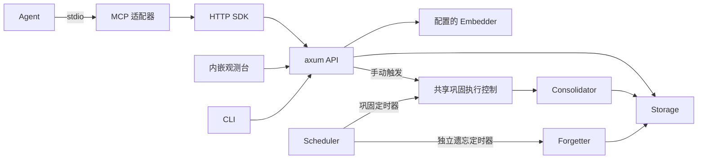
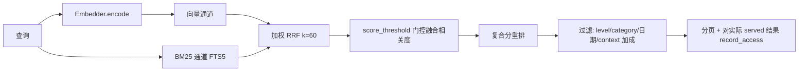
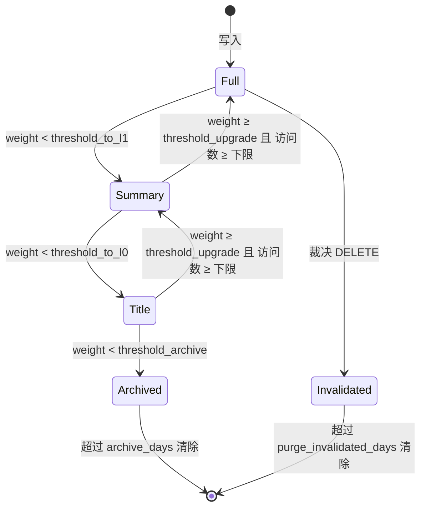
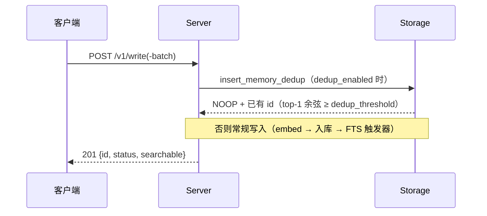

# MerkurDB — 技术架构

> [English](ARCHITECTURE.md)

## Crate 结构与依赖

```
crates/
├── core/                # 类型、trait、错误、融合/打分逻辑
├── storage/             # SqliteStorage + LanceDbStorage（feature-gated）
├── embedders/           # NoopEmbedder + OllamaEmbedder + OpenAIEmbedder
├── consolidators/       # NoopConsolidator + LlmConsolidator
├── forgetters/          # EbbinghausForgetter
├── server/              # axum HTTP 服务 + Scheduler（巩固/遗忘 tick）
├── client/              # Rust SDK（MerkurClient trait + HttpMerkurClient）
├── cli/                 # merkurctl 管理 CLI
├── mcp/                 # 使用 HTTP SDK 的 stdio MCP 适配器
└── eval/                # merkur-eval：LoCoMo + PersonaMem benchmark harness
```

**依赖方向**：领域类型与接口位于 `core`；存储和插件实现这些接口，由 `server` 组合。`client` 依赖 `core` 和 HTTP。MCP 与评测使用 `client`，CLI 直接调用 HTTP。MCP 复用服务端配置的 Embedding 和治理逻辑。



## 插件 Trait 体系

四个 trait，经配置注入，可独立替换：

| Trait | 实现 | 说明 |
|---|---|---|
| `Embedder` | Noop / Ollama / OpenAI 兼容 | 启动时向探针请求自动探测 `dim()`，存储自适应 |
| `Storage` | SqliteStorage / LanceDbStorage | 完整读写面：记忆、边、FTS5 文本搜索、命名空间向量搜索、BFS 扩展、巩固簿记、软失效、`record_access`、批量取向量 |
| `Consolidator` | Noop / LLM（Ollama 或 OpenAI 兼容，可选 bearer + 超时） | `consolidate()` 产出摘要/重要性/边；`adjudicate()` 产出 ADD/UPDATE/DELETE/NOOP 裁决 |
| `Forgetter` | Ebbinghaus | `compute_weight` + `decide`（降级/归档/回升） |

权威定义见 `crates/core/src/traits.rs`；实现插件 = 实现 trait + 在 `config.rs` 加配置 + 在 `main.rs` 接线 + 在 `config.example.yaml` 写文档。

## 数据模型

`Memory`：

| 字段组 | 字段 | 说明 |
|---|---|---|
| 标识 | `id` | 系统生成 |
| 内容 | `content`、`abstract_` | `abstract_` 仅由 Consolidator 写入 |
| 显著性 | `weight`、`importance`、`access_count`、`accessed_at` | `weight` 由遗忘曲线衰减；`importance` 由 Consolidator 评估（客户端不可上报）；访问仅在服务点记账 |
| 分类 | `category`、`level`（Full=2 / Summary=1 / Title=0 / Archived=-1）、`context`、`metadata` | |
| 租户 | `namespace` | 所有检索路径按桶隔离 |
| 时态 | `created_at`、`updated_at`、`valid_at`、`invalid_at` | `valid_at` 从 `created_at` 回填；`invalid_at` 置位 = 软失效（检索不可见，清除前可审计） |
| 巩固 | `pending_consolidation`、`embedding` | |

`Edge`：`source_id`/`target_id`/`weight`/`relation`/`edge_type`（System = LLM 创建，BFS 双向；Manual = 客户端创建，有向）。

## 存储层

### SqliteStorage（默认）
- **元数据**：SQLite，WAL 模式，r2d2 连接池
- **向量索引**：`InMemoryVectorIndex` —— `parking_lot::RwLock`，并行数组 + HashMap，O(n log k) top-k，L2 范数预缓存
- **持久化**：向量保存在 `memories.embedding`，启动时加载到内存索引
- **表**：`memories`、`edges`、`context_tags`、`consolidate_log`、`memories_fts`（FTS5，触发器同步所有写路径）、`merkur_meta`（schema 版本）
- **迁移**：逐版本、事务化、可重放；半成品迁移的库启动时自愈

### LanceDbStorage（feature `lancedb`）
- **元数据**：SQLite（同一套 DDL、同一套迁移）
- **向量**：LanceDB 磁盘存储，超过 256 行自动建 IVF 索引
- **依赖**：`protoc`（仅构建期）、`--features lancedb`

### 共享 SQL 逻辑
`sqlite_helpers.rs` 供两个后端共享行投影（`get_memory_row`）、批量向量获取、BFS、审计簿记和元数据操作。`mark_consolidated_if_unchanged` 在确认完成前原子比较原文。各后端的向量写入由其存储实现处理。当前数据库 schema 为 v6，`consolidate_log` 包含吸收和失效计数。

## 检索系统

`GET /v1/search` 三种模式：

| 模式 | 路径 | 分数语义 |
|---|---|---|
| `hybrid`（默认） | BM25（FTS5 trigram）+ 向量余弦，各自超采，RRF 融合，复合分重排 | composite = `score_search·fused + score_weight·weight + score_importance·importance` |
| `fast` | 向量 top-k | 原始余弦 |
| `deep` | 向量种子 + 以种子分锚定的 CTE BFS 图扩散（种子与邻居按分合并去重） | 邻居分 = `种子分 × 路径边权积 × 0.5^depth` |



融合旋钮位于 `retrieval.fusion.*`（`rrf_k`、通道权重、复合份额）—— 可用 `MERKUR_RETRIEVAL__FUSION__*` 环境变量覆盖。

**访问信号纪律**：检索方法全部纯读（无副作用）；`record_access` 仅由服务点（search handler、`/v1/context`，包括经 HTTP 转发的 MCP 请求）对实际 served 的结果调用。

## 认知管线

### 生命周期



- 权重：`w(t) = w₀ · exp(-Δt·ln2/h) · min(1 + β·log₂(1+n), 3.0)` —— `h = half_life_seconds`，`β = access_boost`，`n = access_count`
- 回升带滞回门（`threshold_upgrade` 必须高于 `threshold_to_l1`；权重与访问数双门槛），热点记忆可爬回且不振荡
- 软失效（`invalid_at`）是系统专属移除通道；客户端 `DELETE` 仍是立即硬删

### 写路径



去重探测为纯读（不污染访问信号）；探测失败时回退为常规插入。

### 巩固 tick

```mermaid
sequenceDiagram
    participant S as Scheduler
    participant D as Storage
    participant L as Consolidator (LLM)

    S->>D: list_pending(batch_size)
    S->>L: consolidate(pending)
    L-->>S: 摘要 + 重要性 + 边
    S->>D: update_abstract / update_importance / insert_edge
    rect rgb(40, 40, 40)
        Note over S,L: 裁决阶段（adjudication_candidates > 0）
        S->>D: get_embeddings(pending) + vector_search_ns（同桶候选）
        Note over S: 候选先按 floor 预过滤（全低于 floor 的集合跳过 LLM 调用）；<br/>收集相 4 路并发（只读），执行相按序串行（写）
        S->>L: adjudicate(pending, candidates)
        L-->>S: 每条记忆的 ADD/UPDATE/DELETE/NOOP
        S->>D: 仅当余弦 ≥ adjudication_floor 才执行
        Note over S,D: UPDATE 就地吸收（absorbed_into 审计指针）；<br/>DELETE 置 invalid_at；不可解析输出坍缩为 ADD
    end
    S->>D: mark_consolidated_if_unchanged（符合条件的 id 与处理时原文）
    S->>D: log_consolidation(report)
```



手动与定时巩固共用进程内执行锁；重复手动触发返回 `409 CONSOLIDATION_RUNNING`。任务一旦启动，HTTP 客户端断开不会取消它。定时遗忘使用独立循环，正常关机等待已启动的巩固结束。

`GET /v1/status` 的 `consolidation` 对象描述本进程中当前或最近一次批次，重启后重置：

| 状态 | 含义 |
|---|---|
| `idle` | 本进程尚未启动过批次 |
| `running` | 一个批次持有执行锁；处理数和错误数在结束前为零 |
| `succeeded` | 最近一次批次返回且没有报告错误；队列仍可能有待处理记忆 |
| `failed` | 最近一次批次报告错误、panic 或被取消；执行锁已释放 |

状态还包含 `started_at`、`finished_at`、`processed` 和 `errors`。`processed` 是 consolidator 报告的处理数，不是已清除的 pending 数量。终态在裁决、完成标记和尝试写入审计日志后发布。日志写入失败会使任务失败，但不会撤销之前的完成标记。panic 等来不及写审计报告的异常通过任务状态和服务日志体现。

只有摘要已落盘的 id 才有资格标记完成。没有抽取、落盘或裁决错误时，完成标记在 SQLite 中原子比较处理时的原文；并发修改的记忆和被吸收改写的目标继续保留 pending。失败批次留下的 pending 供后续重试，已经应用的写入不回滚。整批操作不具备事务性，执行锁也不协调多个服务进程。默认 Noop consolidator 不产出摘要，因此不清除 pending。

Storage API 允许向量为空。无向量记忆跳过向量裁决，仍可完成抽取；批量读取向量、候选搜索和裁决的实际错误则计为失败。等待队列处理完需同时满足 `pending_consolidation == 0` 且任务为 `idle` 或 `succeeded`。SDK 暴露这两个字段，评测等待逻辑检查两者，控制台显示对应快照。

## 配置

优先级：`--config YAML` > `MERKUR_*` 环境变量（`__` 分层）> 内建默认值。启动校验拒绝矛盾或越界配置（阈值序、dedup/fusion 区间、保留键）。

完整带注释示例见 [`config.example.yaml`](../config.example.yaml)。配置段：`server`（host/port/cors/dev_mode）· `storage`（sqlite/lancedb）· `plugins.embedder`（noop/ollama/openai）· `plugins.consolidator`（noop/llm + backend/api_key/timeout_seconds）· `retrieval`（限额、阈值、`fusion.*`）· `auth`（tokens/disabled）· `consolidation`（interval/batch/adjudication_floor/candidates）· `forgetting`（衰减/阈值/回升/清除窗口）· `write`（dedup）· `logging` · `rate_limit`。

## API 面

`/v1` 下的 HTTP 接口（见 [`openapi.yaml`](../openapi.yaml)）：

- 公开：`GET /health`、`GET /metrics`（Prometheus）
- 写入：`POST /write`、`POST /write-batch`
- 读取：`GET /search`、`GET /memories`、`POST /context`、`GET /memory/{id}`、`GET /graph/{id}`、`GET /status`
- 修改/删除：`PUT /memory/{id}`、`DELETE /memory/{id}`
- 生命周期：`POST /consolidate`、`GET /consolidate/log`、`POST /forget`
- 图：`POST /relate`、`POST /relate-batch`

公开的 `/ui`、`/ui/app.js` 和 `/ui/style.css` 静态资源内嵌于二进制，控制台通过受保护的 HTTP API 获取数据。

认证：`Authorization: Bearer <token>`（恒定时间比较）；`X-Merkur-Namespace` 将写入/搜索/context/图限定到单桶，浏览和图接口的查询参数可覆盖该桶。按 ID 操作直接访问记录；namespace 不构成授权边界。错误信封为 `{"error": {"code", "message"}}`；常见错误码包括 401 UNAUTHORIZED、409 CONSOLIDATION_RUNNING、429 RATE_LIMITED、502 EMBED_FAILED，以及 write-batch 全失败时的 207。

## Feature Gates

| Feature | 依赖 | 效果 |
|---------|------|------|
| `ollama`（默认） | reqwest | OllamaEmbedder |
| `openai` | reqwest | OpenAIEmbedder（+ consolidator OpenAI 后端） |
| `lancedb` | lancedb + arrow + protoc | LanceDbStorage |

## 技术栈

| 层 | 选择 | 理由 |
|----|------|------|
| HTTP | axum 0.8 | Tokio 生态，异步 |
| SQLite | rusqlite（bundled） | 零系统依赖 |
| 向量 | 内存索引；LanceDB feature | 默认扫描内存中的向量；LanceDB 提供磁盘存储方案 |
| 序列化 | serde + serde_json | Rust 标准 |
| 配置 | figment | YAML + env 分层合并 |
| 日志 | tracing | 结构化 |
| 错误 | thiserror | derive 宏 |
| 部署 | 单二进制 + Docker | 零运行时依赖 |
